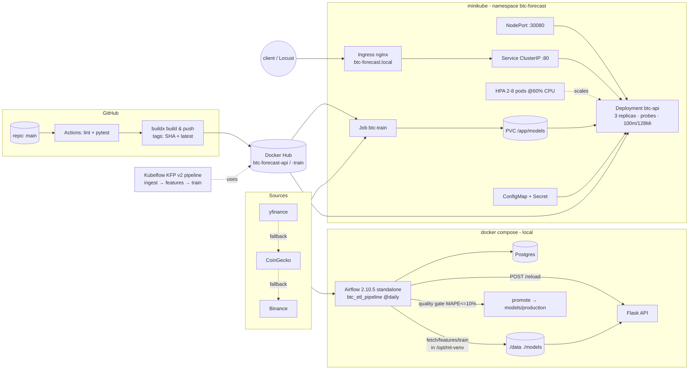

# BTC-USD 7-Day Forecast: Production MLOps Pipeline

[](https://github.com/samiurkhan10-rgb/btc-forecast-mlops/actions/workflows/ci_cd.yml)
[](https://hub.docker.com/r/samiurk/btc-forecast-api)
[](https://hub.docker.com/r/samiurk/btc-forecast-train)

MLOps Assignment 3, group of 2:
**Sami ur Rehman Khan (25L-8005)** and **Muhammad Faizan Aslam (25L-8011)**.

An end-to-end system that ingests daily Bitcoin prices, retrains an XGBoost forecaster, gates and
promotes the model, serves a 7-day close-price forecast from a Flask/gunicorn microservice, and runs it
on Kubernetes with probes, persistent storage, an Ingress and a CPU-based autoscaler.
CI/CD builds, tests and publishes the images on every push.

| Docker Hub | |
|---|---|
| API image | https://hub.docker.com/r/samiurk/btc-forecast-api |
| Training image | https://hub.docker.com/r/samiurk/btc-forecast-train |

---

## Architecture



**One code base, four runners.** All logic lives in `src/`. The Airflow DAG, the K8s training Job,
the Kubeflow container components (`python -m src.cli …`) and the API (`src.features`, `src.forecast`)
call the same functions, so nothing is duplicated.

## Model

- **XGBoost** (`xgboost-cpu`, 300 rounds, depth 3) predicting the **next-day log return**. Tree models
  cannot extrapolate beyond the target range seen in training, and BTC keeps reaching new highs,
  so the price is rebuilt as `close × e^return`.
- Features: 7 lagged log returns, close/MA7 − 1, close/MA30 − 1, 7-day and 30-day volatility, day of week.
- **Recursive multi-step forecast**: predict day t+1, append it, recompute features, and repeat for 1–30 days.
- Evaluation on the **latest 7-day holdout**, forecast recursively exactly like the API:
  MAE / RMSE / MAPE plus a naive "tomorrow = today" baseline. A model is promoted only if MAPE ≤ 10 %.
- Typical result: MAPE ≈ 4 % (the naive baseline is ≈ 3.6 %, which is typical for a near-random-walk series).

## Repository layout

```
app/            Flask API (app.py), model store with hot reload, multi-stage Dockerfile
src/            config, etl_fetch, features, forecast, train_forecast, registry, cli, logging
dags/           Airflow DAG btc_etl_pipeline.py
kubeflow/       KFP v2 pipeline (btc_kfp_pipeline.py) + compiled btc_kfp_pipeline.yaml
k8s/            namespace, configmap-secret, pvc, deployment, service, hpa, ingress, train-job
docker/         Dockerfile.train (Job/KFP), Dockerfile.airflow (Airflow + isolated ML venv)
loadtest/       locustfile.py
tests/          72 offline pytest tests (network blocked), ~97 % coverage
.github/workflows/ci_cd.yml
docs/           assignment, report outline and evidence log
```

## API

Base URL: `http://localhost:5000` (compose) · `http://btc-forecast.local` (K8s Ingress).

| Method | Path | Description | Errors |
|---|---|---|---|
| GET | `/health` | status, uptime, model version, whether a model is loaded (always 200 for probes) | n/a |
| POST | `/predict` | 7-day (or `forecast_days` 1–30) forecast; optional `history` array (≥ 31 prices) | 400 bad input · 503 no model · 500 |
| GET | `/metrics` | MAE / RMSE / MAPE of the latest validation run + naive baseline | 503 no model |
| POST | `/reload` | re-read model files (header `X-API-Key`) | 401 · 403 · 503 |

```powershell
Invoke-RestMethod http://btc-forecast.local/health
# status: ok | uptime_seconds: 176.6 | model_loaded: True | model_version: 20261123T011108Z | model_stage: production

Invoke-RestMethod -Method Post http://btc-forecast.local/predict -ContentType 'application/json' `
    -Body '{"forecast_days": 7}' | ConvertTo-Json -Depth 4
```
```json
{
  "model_version": "20261123T011108Z",
  "forecast_days": 7,
  "input_source": "model_history",
  "last_observed_date": "2026-11-21",
  "last_observed_close": 60094.09,
  "predictions": [
    {"date": "2026-11-22", "predicted_close": 60345.92},
    {"date": "2026-11-23", "predicted_close": 60757.28},
    {"date": "2026-11-24", "predicted_close": 60724.31},
    {"date": "2026-11-25", "predicted_close": 60236.31},
    {"date": "2026-11-26", "predicted_close": 60824.36},
    {"date": "2026-11-27", "predicted_close": 60449.09},
    {"date": "2026-11-28", "predicted_close": 60730.09}
  ]
}
```
Custom history: `{"history": [<31+ closing prices>], "forecast_days": 3}`.
Validation error example: `{"forecast_days": 0}` → `400 {"error": "forecast_days must be between 1 and 30", "status": 400}`.
`GET /metrics` → `{"model_version": "...", "metrics": {"mae": 2529.5, "rmse": 3465.3, "mape": 4.18, "baseline_naive": {...}, "holdout_start": "2026-11-15", "holdout_end": "2026-11-21", ...}}`.

## Running it on Windows

Prerequisites: Python 3.10, Docker Desktop (WSL2), minikube + kubectl, Git.
All commands are **PowerShell** from the repo root. Do not run compose and minikube at the same time
on a low-memory machine.

### 1. Local dev and tests
```powershell
python -m venv .venv
.venv\Scripts\python -m pip install -r requirements-dev.txt
.venv\Scripts\python -m pytest              # 72 tests, all network calls mocked
.venv\Scripts\flake8 . ; .venv\Scripts\black --check .
.venv\Scripts\python -m src.cli all         # fetch -> features -> train -> promote into .\models
```
(gunicorn does not run on Windows; the API is served by gunicorn inside the container.)

### 2. Docker Compose (API + Airflow + Postgres)
```powershell
Copy-Item .env.example .env                 # then set API_KEY, AIRFLOW_ADMIN_PASSWORD, ...
docker compose up -d --build --wait
# API      http://localhost:5000/health
# Airflow  http://localhost:8080  (admin / AIRFLOW_ADMIN_PASSWORD) -> unpause/trigger btc_etl_pipeline
docker compose down                         # keep the volume (no -v) to keep Airflow history
```

### 3. Kubernetes (minikube, docker driver)
```powershell
minikube start                              # with ingress + metrics-server addons enabled
kubectl apply -f k8s/namespace.yaml -f k8s/configmap-secret.yaml
# replace the placeholder secret with the real key from .env
$key = (Select-String '^API_KEY=' .env).Line.Split('=',2)[1]
kubectl -n btc-forecast create secret generic btc-api-secret --from-literal=API_KEY=$key `
    --from-literal=COINGECKO_API_KEY= --dry-run=client -o yaml | kubectl apply -f -
kubectl apply -f k8s/pvc.yaml -f k8s/deployment.yaml -f k8s/service.yaml -f k8s/hpa.yaml -f k8s/ingress.yaml
kubectl -n btc-forecast rollout status deploy/btc-api
kubectl apply -f k8s/train-job.yaml         # trains into the PVC; pods pick the model up in ~5 s
kubectl -n btc-forecast get all,pvc,ingress,hpa
```
Access:
- **NodePort:** `minikube service btc-api-nodeport -n btc-forecast --url` (keep the window open).
- **Ingress:** add `127.0.0.1 btc-forecast.local` to `C:\Windows\System32\drivers\etc\hosts`
  (Administrator) and keep `minikube tunnel` running in an Administrator terminal.

### 4. Load test / autoscaling
```powershell
kubectl -n btc-forecast get hpa btc-api --watch                          # window 1
kubectl -n btc-forecast get pods -l app.kubernetes.io/name=btc-api -w    # window 2
.venv\Scripts\locust -f loadtest\locustfile.py --host http://btc-forecast.local `
    --headless -u 60 -r 5 -t 4m --html loadtest\results\report.html     # window 3
```
Result (60 users): 7,315 requests, **0 failures**, ~31 req/s, HPA 2 → 8 pods, 0 restarts.

### 5. Kubeflow pipeline (compile only, no cluster needed)
```powershell
python -m venv .venv-kfp ; .venv-kfp\Scripts\python -m pip install -r requirements-kfp.txt
.venv-kfp\Scripts\python kubeflow\btc_kfp_pipeline.py --image-tag <commit-sha>
```

## CI/CD (`.github/workflows/ci_cd.yml`)
- On every push to `main` and every PR: **lint** (flake8 + black) and **test** (pytest + coverage)
  on Python 3.10 with pip caching.
- On push to `main` only, after both pass: **build-and-push** logs in to Docker Hub with the
  `DOCKER_USERNAME` / `DOCKER_PASSWORD` secrets, builds `app/Dockerfile` and `docker/Dockerfile.train`
  with buildx + GHA layer cache, tags `:<commit-sha>` and `:latest`, pushes, then smoke-tests the
  pushed API image.

## Design notes and known limitations
- **Airflow 2.10.5** is past end-of-life. It was chosen because it fits in one container on a 6 GB machine.
  Airflow core is installed strictly with the official constraints file. ML tasks run in a separate
  venv (`ExternalPythonOperator`) because the constraints pin `cffi==1.17.1` while yfinance needs ≥ 2.1.1.
- **ReadWriteOnce PVC** only works because minikube is a single node. Multi-node clusters need RWX storage
  or an object store for models.
- **Capacity** is bounded by the 2-vCPU minikube node (~30 req/s at 6–8 pods). A real cluster would add the
  Cluster Autoscaler.
- **API image** is 376 MB uncompressed / 122 MB compressed. scipy (~112 MB) is a hard dependency of xgboost.
- The Kubeflow pipeline is compiled and its container commands were verified locally. No Kubeflow cluster
  was installed (resource limits).
